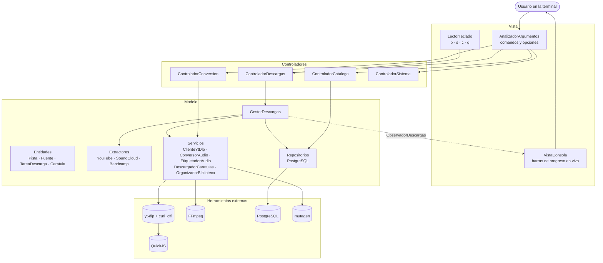
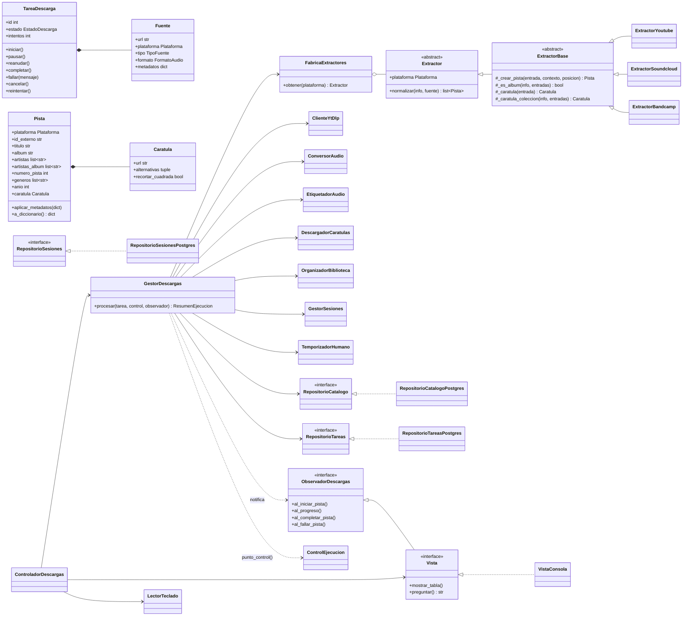
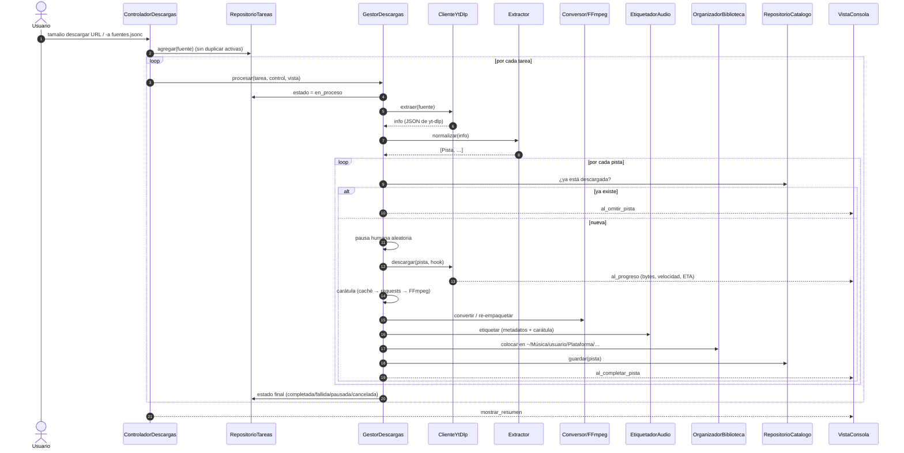
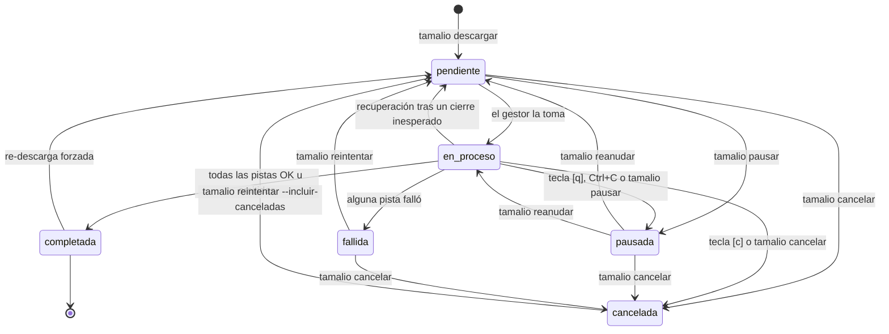
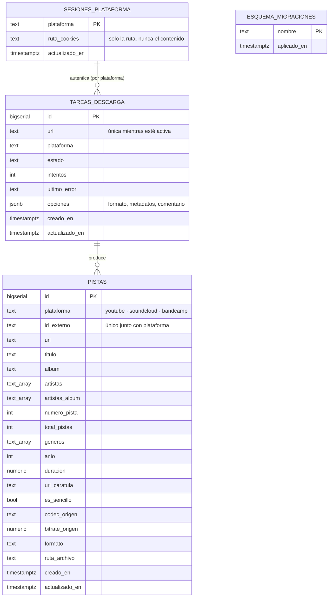
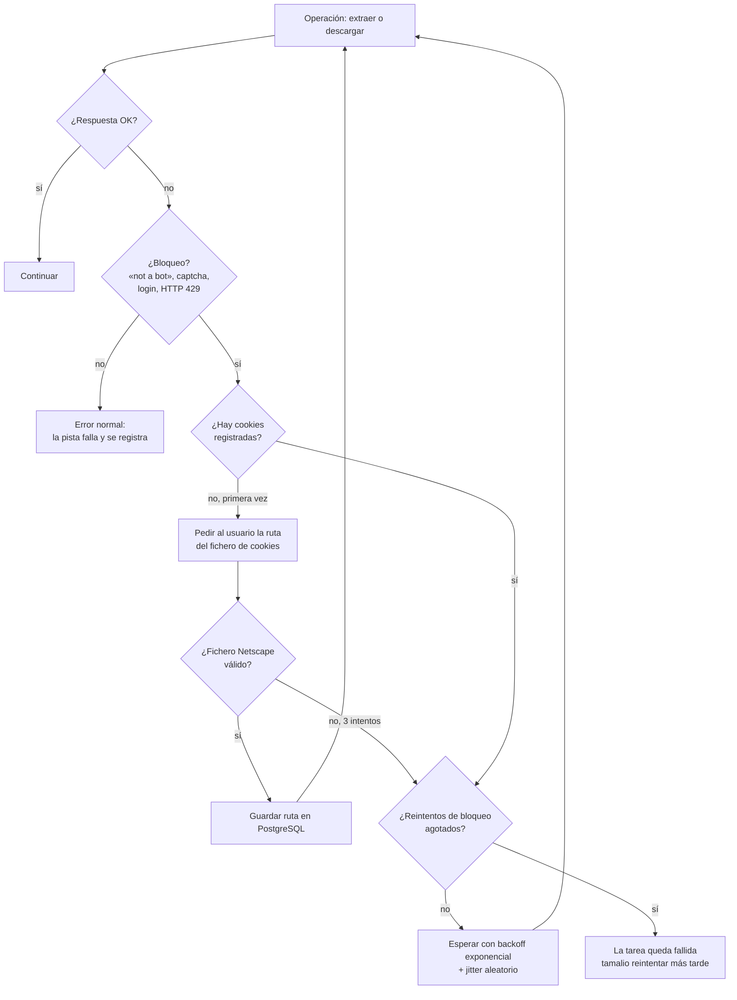
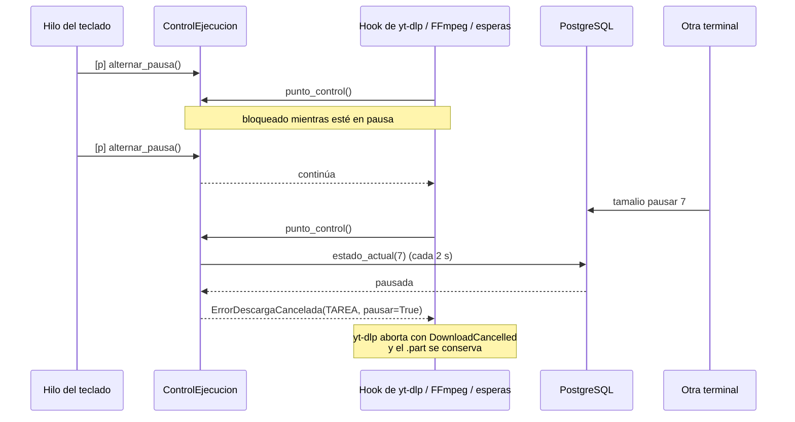
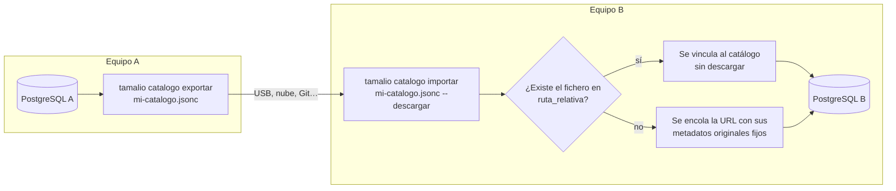
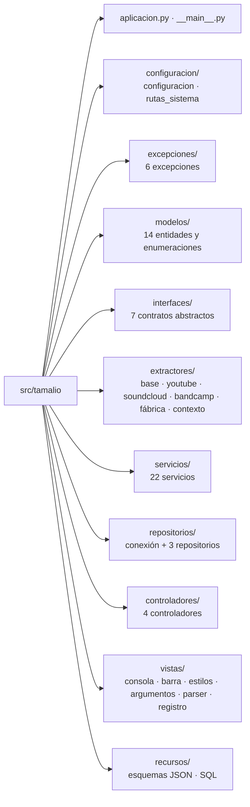

# Arquitectura de Tamalio

Este documento describe cómo está construido Tamalio. Todos los diagramas
están en [Mermaid](https://mermaid.js.org/) y GitHub los dibuja directamente.

## Contenido

1. [Capas MVC](#1-capas-mvc)
2. [Diagrama de clases](#2-diagrama-de-clases)
3. [Secuencia de una descarga](#3-secuencia-de-una-descarga)
4. [Estados de una tarea](#4-estados-de-una-tarea)
5. [Modelo de datos (PostgreSQL)](#5-modelo-de-datos-postgresql)
6. [Estrategia anti-bloqueo](#6-estrategia-anti-bloqueo)
7. [Pausa, salto y cancelación](#7-pausa-salto-y-cancelación)
8. [Exportar e importar el catálogo](#8-exportar-e-importar-el-catálogo)
9. [Organización de ficheros del código](#9-organización-de-ficheros-del-código)

---

## 1. Capas MVC

Tamalio sigue el patrón **Modelo-Vista-Controlador**. La regla de oro: el
modelo nunca importa nada de la vista. Cuando necesita informar algo (avance,
errores), lo hace mediante la interfaz `ObservadorDescargas`, que la vista
implementa.

| Capa | Paquete | Responsabilidad |
|------|---------|-----------------|
| Vista | `tamalio.vistas` | Analizar argumentos, dibujar progreso, preguntar al usuario. |
| Controlador | `tamalio.controladores` | Un controlador por grupo de comandos; une vista y modelo. |
| Modelo | `tamalio.modelos`, `servicios`, `extractores`, `repositorios` | Entidades, reglas de negocio y persistencia. |
| Contratos | `tamalio.interfaces` | Clases abstractas que permiten cambiar implementaciones (p. ej. pruebas en memoria). |
| Composición | `tamalio.aplicacion` | Único lugar que crea las clases concretas y las conecta (inyección de dependencias). |

---

## 2. Diagrama de clases

Clases principales y sus relaciones (se omiten atributos menores).

**Patrones de diseño usados**

| Patrón | Dónde | Para qué |
|--------|-------|----------|
| *Template Method* | `ExtractorBase` | El algoritmo de normalización es común; cada plataforma redefine «ganchos». |
| *Factory* | `FabricaExtractores`, `FabricaLectoresFuentes` | Elegir la implementación correcta sin `if` repartidos por el código. |
| *Chain of Responsibility* | `FabricaLectoresFuentes` | Cada lector decide si «admite» el fichero. |
| *Observer* | `ObservadorDescargas` | El modelo informa el avance sin conocer a la vista. |
| *Repository* | `repositorios/` | Aislar SQL del resto de la aplicación. |
| *State* (tabla de transiciones) | `EstadoDescarga`, `TareaDescarga` | Impedir cambios de estado inválidos. |
| *Composition Root* | `Aplicacion` | Un único lugar crea y conecta los objetos. |

---

## 3. Secuencia de una descarga

---

## 4. Estados de una tarea

> Al **pausar** se conservan los ficheros `.part` de `yt-dlp` para continuar
> donde se quedó; al **cancelar** o **saltar** se borran.

---

## 5. Modelo de datos (PostgreSQL)

La relación tarea → pistas es lógica (una tarea de álbum genera varias pistas)
y no se modela con clave foránea: una pista puede llegar desde distintas tareas
o desde la importación de un catálogo.

---

## 6. Estrategia anti-bloqueo

Medidas preventivas activas siempre:

- **Suplantación de navegador** con `curl_cffi` (`impersonate`), recomendada por
  la documentación de `yt-dlp` para sitios con *TLS fingerprinting*.
- **Esperas aleatorias** entre pistas (distribución triangular + ruido gaussiano
  con `random.SystemRandom`) y **pausas largas** cada 8–15 pistas.
- **Espera aleatoria entre peticiones internas** (`sleep_interval_requests`).
- **QuickJS** para resolver los retos JavaScript de YouTube sin Deno.
- Una sola conexión de fragmentos a la vez y reanudación de `.part`.

---

## 7. Pausa, salto y cancelación

| Tecla | Acción | Resultado |
|-------|--------|-----------|
| `p` | Pausar / reanudar | La descarga se congela sin cerrar el fichero parcial. |
| `s` | Saltar pista | Se borra el parcial y se sigue con la siguiente pista. |
| `c` | Cancelar tarea | La tarea queda *cancelada*; se sigue con la siguiente tarea. |
| `q` / `Ctrl+C` | Salir | La tarea actual queda *pausada*; `tamalio reanudar` continúa. |

---

## 8. Exportar e importar el catálogo

El fichero exportado cumple `catalogo.schema.json`, guarda rutas **relativas**
a la biblioteca (con `/` también en Windows) y nunca contiene audio ni cookies.

---

## 9. Organización de ficheros del código

Cada clase, entidad, interfaz, clase abstracta, vista y controlador vive en su
propio fichero, con documentación en español y *docstrings*.

